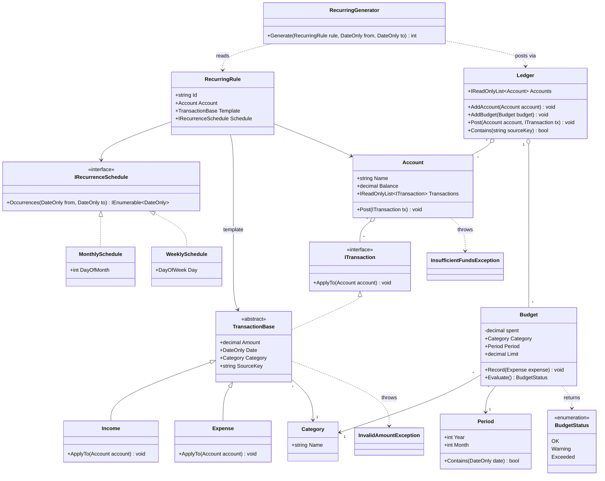

# Class Diagram v2 (Tuần 2)

Phạm vi: `Budget`, giao dịch định kỳ, nhiều tài khoản qua `Ledger`.
Báo cáo, trend, net worth: dự kiến v3.

## Sơ đồ

## Thay đổi so với v1

| Hạng mục mới | Vai trò | Thành viên | File |
|---|---|---|---|
| `Budget`, `BudgetStatus`, `Period` | Theo dõi chi theo category theo kỳ, tự đánh giá trạng thái | A (Phước) | [link file] |
| `InvalidAmountException` | Từ chối số tiền không hợp lệ | A (Phước) | [link file] |
| `IRecurrenceSchedule`, `MonthlySchedule`, `WeeklySchedule` | Điểm mở rộng cho lịch định kỳ | B (Thư) | [link file] |
| `RecurringRule`, `RecurringGenerator` | Sinh giao dịch theo khoảng ngày | B (Thư) | [link file] |
| `Ledger` | Quản lý nhiều `Account` và `Budget`; kiểm tra trùng qua `Contains` | B (Thư) | [link file] |
| `TransactionBase.SourceKey` | Khóa `RuleId:OccurrenceDate`, dùng chống sinh trùng | B (Thư) | [link file] |
\